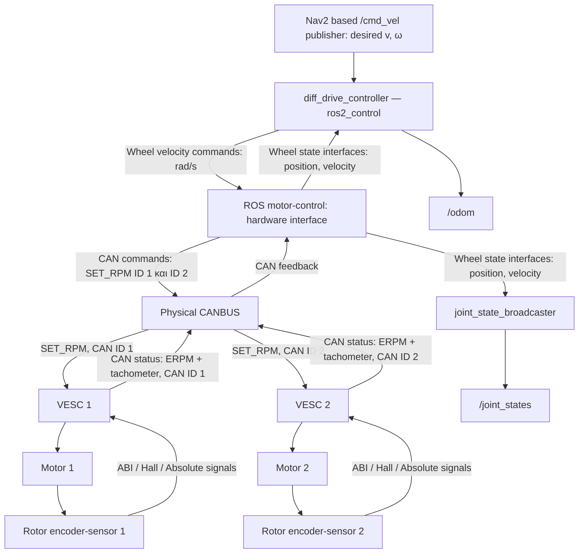

# VIRTUAL MOTOR-ENCODER DEVELOPMENT USING CANBUS AND VESC

> Η τρέχουσα υλοποίηση πραγματικών VESC, η C++ Waveshare bridge και οι
> εντολές ενός/δύο motors τεκμηριώνονται στο
> [docs/VESC/real-vesc-control.md](docs/VESC/real-vesc-control.md).
> Οι παλαιότερες ενότητες fake motor/encoder παρακάτω διατηρούνται ως ιστορικό
> development tutorial και δεν ορίζουν τις παραμέτρους του hardware plugin.

We isolate the development of iwalk-motor controllers. To do that we use the flow presented bellow.

We want the real system to work like this:
-----------------

## **TUTORIAL**

## Launch arguments (`vesc_control.launch.py`)

| Argument | Default | Meaning |
| --- | --- | --- |
| `can_interface` | `vcan0` | SocketCAN interface: `vcan0` when using the Waveshare bridge, or a physical CAN interface such as `can0`. |
| `single_motor` | `true` | `true`: left wheel only with ForwardCommandController. `false`: both wheels with DiffDriveController. |
| `monitor_only` | `false` | `true`: monitor feedback without sending motor commands. |
| `feedback_timeout` | `0.2` | Maximum permitted feedback age in seconds before the hardware plugin treats it as stale. |
| `left_vesc_id` / `right_vesc_id` | `1` / `2` | CAN IDs configured in VESC Tool. |
| `left_direction` / `right_direction` | `1` / `1` | Direction multiplier for each wheel: `1` or `-1`. |

Launch argument defaults are declared in `vesc_control.launch.py`.
Override them using `argument:=value`.

The motor constants `motor_pole_pairs`, `motor_gear_ratio`, and
`motor_max_erpm` are configured in `iwalk.urdf.xacro`.
They are not exposed as launch arguments by this launch file.

The documented Xacro defaults are:

- `motor_pole_pairs`: `15`
- `motor_gear_ratio`: `1.0`
- `motor_max_erpm`: `7500`

When using Waveshare, start the bridge separately.
`vesc_control.launch.py` does not start it.
